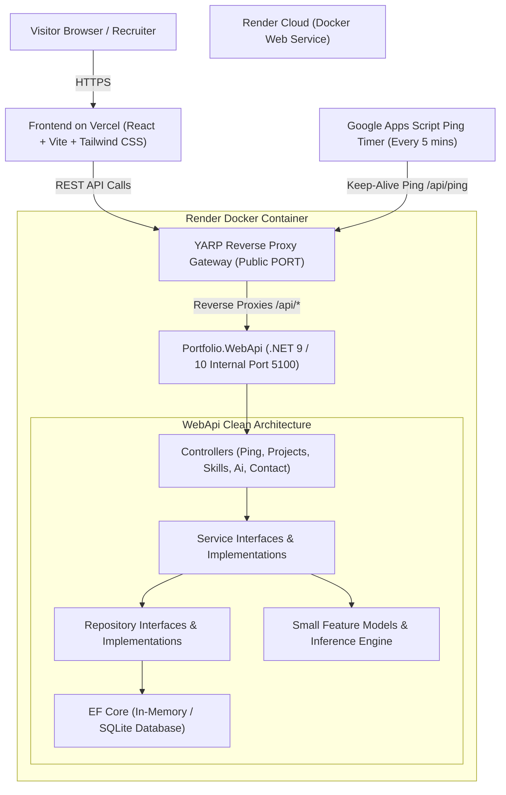

# Darshan Ubhale — Full-Stack AI & .NET Portfolio

[](https://react.dev/)
[](https://tailwindcss.com/)
[](https://dotnet.microsoft.com/)
[](https://microsoft.github.io/reverse-proxy/)
[](https://render.com/)

A modern portfolio website and backend architecture designed for **Darshan Ubhale** (AI & Data Science Engineer, Full Stack .NET Developer, and Former Scrum Pod Leader at Cognizant).

---

## 🏛️ System Architecture



---

## 📁 Repository Structure

```
├── frontend/                     # React + Vite + Tailwind CSS Client
│   ├── public/                   # Favicon and assets
│   ├── src/
│   │   ├── components/           # Navbar, Hero, About, Projects, Skills, AiPlayground, Contact, Footer, PingStatusBadge
│   │   ├── data/                 # resumeData.ts (accurate resume information)
│   │   ├── services/             # apiService.ts (communicates with YARP backend + offline resilience)
│   │   ├── App.tsx
│   │   ├── main.tsx
│   │   └── index.css
│   ├── package.json
│   ├── vite.config.ts
│   ├── vercel.json               # Vercel deployment configuration with SPA routing
│   └── .env.example
│
├── backend/                      # .NET Core Multi-Project Solution
│   ├── Portfolio.slnx            # Solution file
│   ├── Portfolio.Gateway/        # YARP Reverse Proxy & Gateway Service
│   │   ├── Program.cs            # Dynamic port binding & proxy forwarding
│   │   └── appsettings.json      # Reverse proxy route rules
│   │
│   ├── Portfolio.WebApi/         # Core Web API Application
│   │   ├── Controllers/          # PingController, ProjectsController, SkillsController, ContactController, AiFeaturesController
│   │   ├── Services/             # Business Logic & AI Engines
│   │   │   └── Interfaces/       # IPingService, IProjectService, ISkillService, IContactService, IAiFeatureService
│   │   ├── Repositories/         # Data Access Layer
│   │   │   └── Interfaces/       # IProjectRepository, ISkillRepository, IExperienceRepository, IContactRepository
│   │   ├── Models/               # Entities and DTOs
│   │   ├── Data/                 # PortfolioDbContext & DbInitializer (automatic seeding)
│   │   └── Program.cs
│   │
│   ├── Dockerfile                # Production multi-stage Docker build for Render
│   ├── entrypoint.sh             # Launches WebAPI & YARP Gateway together
│   └── .dockerignore
│
├── keep-alive/
│   ├── google-apps-script.js     # Ready-to-use Google Apps Script to ping Render every 5 mins
│   └── README.md                 # Setup walkthrough for 24/7 uptime
│
├── .github/
│   └── workflows/
│       └── keep-alive-cron.yml   # Backup GitHub Actions scheduled keep-alive ping
│
├── render.yaml                   # Render Blueprint descriptor
└── README.md
```

---

## 🚀 Key Features & Resume Projects

### 1. WellBeing360 – Employee Wellness Platform (.NET 9, React, TypeScript, YARP)
- Developed during Darshan's internship at **Cognizant** as **Project Leader**.
- Features 4 decoupled ASP.NET Core microservices routed through a high-performance **YARP Gateway**.
- Includes JWT authentication, role-based authorization, and EF Core reporting.

### 2. AI Code Copilot (React, Spring Boot, FastAPI, LangChain, FAISS)
- Repository-aware AI developer assistant for multi-file code understanding, refactoring, and documentation.
- FastAPI RAG pipeline utilizing LangChain, semantic embeddings, and FAISS vector database.
- Integrated with a Monaco Editor web interface.

### 3. QueryMind AI – SQL Query Generator (React, Node.js, MySQL, Gemini API)
- Converts plain natural language business questions into optimized, dialect-accurate SQL.
- Strict security safeguards blocking destructive commands (`DROP`, `TRUNCATE`, unchecked `DELETE`).
- Interactive live sandbox embedded directly in the portfolio's **AI Features** section.

### 4. Interactive AI Features (Backend Hosted Small Feature Models)
- **Darshan's AI Avatar**: Conversational portfolio assistant answering recruiter questions in milliseconds.
- **Job Description & Skill Matcher**: Evaluates recruiter job descriptions against Darshan's skillset and outputs a match percentage and custom pitch.
- **SQL Generator**: Demonstrates QueryMind AI with interactive execution.
- **Code Reviewer**: Big-O complexity analyzer and refactoring assistant.

---

## 💻 Local Development Setup

### Prerequisites
- Node.js (v18+)
- .NET SDK (v9 or v10)

### 1. Start the Backend & YARP Gateway
```powershell
# Open terminal in project root
cd backend/Portfolio.WebApi
dotnet run --urls "http://127.0.0.1:5100"

# In a separate terminal, start YARP Gateway
cd backend/Portfolio.Gateway
$env:WEBAPI_URL="http://127.0.0.1:5100"
dotnet run --urls "http://localhost:5000"
```
The YARP Gateway is now listening on `http://localhost:5000` and reverse proxying requests to WebAPI on port 5100.

### 2. Start the React Frontend
```powershell
cd frontend
npm install
npm run dev
```
Open **`http://localhost:3000`** in your browser. The frontend Vite server automatically proxies `/api` calls to the Gateway.

---

## 🌐 Deployment Instructions

### Deploy Frontend to Vercel
1. Push this repository to your GitHub account (`github.com/DarshanU25/...`).
2. Go to **[vercel.com](https://vercel.com)** and click **"Add New Project"**.
3. Import your GitHub repository.
4. Set the **Root Directory** to `frontend`.
5. Under **Environment Variables**, add:
   - `VITE_API_BASE_URL` = `https://<YOUR-RENDER-APP-NAME>.onrender.com` (leave blank during initial test to use verified client fallback).
6. Click **Deploy**. Vercel will build and publish your portfolio with HTTPS and global CDN caching.

---

### Deploy Backend Docker on Render
1. Go to **[render.com](https://render.com)** and sign in.
2. Click **New +** -> **Web Service**.
3. Connect your GitHub repository.
4. Set:
   - **Environment**: `Docker`
   - **Region**: Oregon (or nearest)
   - **Branch**: `main`
   - **Dockerfile Path**: `backend/Dockerfile`
   - **Docker Context**: `.` (Root)
5. Under **Environment Variables** (optional):
   - `GEMINI_API_KEY`: *(Optional)* Your Google Gemini API key if you want remote model escalation. If omitted, the embedded small inference engine runs automatically with zero cost!
6. Click **Create Web Service**. Render will build the Docker container and start both WebAPI and YARP Gateway.

---

### ⏰ Setup Keep-Alive Ping Timer (Prevent Render Sleep)
Render's free tier spins down after 15 minutes of inactivity. Keep it 100% warm 24/7 using the free Google Apps Script timer:

1. Open **[script.google.com](https://script.google.com)**.
2. Click **New project**.
3. Open `keep-alive/google-apps-script.js` from this repository, copy its contents, and paste into the script editor.
4. Replace `https://your-backend-app.onrender.com` with your real Render URL.
5. Click **Save** and run `testPing` once to verify `Status: 200`.
6. Click the **Triggers (⏰ clock icon)** on the left -> **Add Trigger**:
   - Function: `pingPortfolioBackend`
   - Event source: `Time-driven`
   - Type: `Minutes timer`
   - Interval: `Every 5 minutes`
7. Click **Save**.

Your backend will now stay awake and respond with sub-second latency for all visitors!

---

## 📬 Contact & Links
- **Name**: Darshan Ubhale
- **Email**: [ubhaledarshan23@gmail.com](mailto:ubhaledarshan23@gmail.com)
- **Phone**: [+91-9699830026](tel:+919699830026)
- **GitHub**: [github.com/DarshanU25](https://github.com/DarshanU25)
- **LinkedIn**: [linkedin.com/in/darshan-ubhale-236248269](https://linkedin.com/in/darshan-ubhale-236248269)
